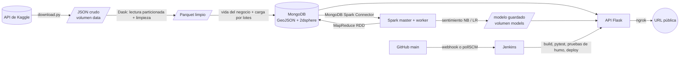

# LifeMap: reputación, ubicación y supervivencia de negocios — Entrega 1

Plataforma batch que descarga el **Yelp Open Dataset** con la API de Kaggle, lo limpia de forma distribuida con **Dask**, guarda los negocios en **MongoDB** como puntos GeoJSON con índice `2dsphere` (con su *vida*: días-negocio, evento de cierre y censura), clasifica el sentimiento de las reseñas con **Spark MLlib**, calcula **tasas de cierre anualizadas con MapReduce (RDD)**, mide el **balanceo de carga** y expone todo en una **API Flask** desplegada. Cada merge a `main` dispara un pipeline de **Jenkins** que construye, prueba y despliega.

**Integrantes:** Miguel Ángel Pérez Martínez · Juan Pablo Ruiz Arizmendi
**Curso:** Big Data · Institución Universitaria de Envigado · 2026-2
**Área y familia:** Saint Louis, MO (área metropolitana) + *Nightlife*

## URL del sistema desplegado

> **https://manlike-distill-poet.ngrok-free.dev**  ← (registrar aquí la URL real; ver "Despliegue")

```bash
curl https://manlike-distill-poet.ngrok-free.dev/health
```

Si se abre en un navegador, el plan gratuito de ngrok muestra primero una página de aviso: pulsar **Visit Site**. Las llamadas de programas (curl, pruebas) no la ven; también se salta con la cabecera `ngrok-skip-browser-warning: 1`.

## Código reutilizado y fuentes

- Infraestructura (Compose, descarga con la API de Kaggle, Dask, MongoDB GeoJSON, Spark con conector, Flask, Jenkins) adaptada de nuestro trabajo geoespacial previo (`procesamiento_geoespacial`, 2026-2).
- MapReduce con `reduceByKey`, tasa anualizada, balanceo con `spark_partition_id()` y benchmark: adaptados de nuestro ejercicio «¿Cuánto viven los discos?» (2026-2).
- El pipeline de sentimiento sigue el diseño de SentimentStream (limpieza, tokenización, stopwords, TF-IDF, Naive Bayes); **se reimplementó** porque ese repositorio no estaba disponible.
- Datos: [Yelp Open Dataset](https://www.kaggle.com/datasets/yelp-dataset/yelp-dataset) (Yelp Inc.), usado según sus términos para fines académicos.
- El desarrollo contó con asistencia de IA (Claude, de Anthropic) para la guía de implementación, la revisión de errores y la redacción.

---

## Arquitectura



| Servicio | Imagen | Rol | Puerto en el host |
| --- | --- | --- | --- |
| `mongo` | `mongo:7.0` | Base de datos con índice 2dsphere | 27017 |
| `dask-scheduler` | `lifemap/dask` | Reparte las tareas de Dask | 8787 (panel) |
| `dask-worker` ×2 | `lifemap/dask` | Limpieza y carga distribuidas | — |
| `ingest` (perfil `jobs`) | `lifemap/dask` | Trabajo: Kaggle → limpieza → vida → MongoDB | — |
| `spark-master` | `lifemap/spark` | Coordina Spark; ahí corre el driver de los jobs | 8081 (panel) |
| `spark-worker` | `lifemap/spark` | Ejecutores (4 núcleos, 2 GB) | — |
| `api` | `lifemap/api` | API Flask con gunicorn | 5000 |
| `jenkins` | `jenkins/` (compose aparte) | CI/CD | 8080 |

**Por qué Jenkins está en un compose aparte (`jenkins/docker-compose.yml`):** si estuviera en el mismo, el pipeline lo recrearía a sí mismo en mitad de un despliegue. El sistema (`docker-compose.yml`) y Jenkins se levantan con dos comandos.

Todos los servicios se comunican por **nombre de servicio** dentro de la red de Compose (`mongo`, `spark-master`, `dask-scheduler`...) y todos tienen *healthcheck*.

## Estructura del repositorio

```
├── docker-compose.yml        # sistema completo
├── config.env                # configuración no secreta (área, geohash, mínimo de días-negocio)
├── .env.example              # plantilla de secretos (el .env real NO se versiona)
├── Jenkinsfile               # pipeline CI/CD
├── jenkins/                  # imagen y compose de Jenkins
├── common/                   # código compartido: geohash, tasas, vida, etiquetas, categorías, métricas
├── ingest/                   # Dask: download, limpieza, vida, carga a Mongo
├── spark/jobs/               # Spark: sentimiento, mapreduce_tasas, balanceo
├── api/                      # Flask: app, validadores, health, predictor, pruebas
├── tests/                    # pytest de common/ e ingest/ (incluye la prueba de la fórmula de la tasa)
├── scripts/                  # spark_submit.sh, tomar_evidencias.sh
└── docs/                     # informe técnico y evidencias
```

---

## Requisitos

- Docker Desktop con Compose v2 (en Windows, con WSL 2). Memoria para Docker: **6 GB o más** (ver `.wslconfig`).
- Git. En Windows, usar **Git Bash** como terminal.
- Una cuenta de Kaggle con un **API token** (Settings → API → *Generate New Token*, empieza por `KGAT_`).
- Disco libre: **~25 GB** (el dataset descomprimido pesa ~9 GB).
- Para la URL pública: cuenta de ngrok con un dominio estático.

Solo en Windows con Git Bash, ejecutar una vez y reabrir la terminal (evita que Git Bash convierta `/data/raw` en una ruta de Windows):

```bash
setx MSYS_NO_PATHCONV 1
```

## Levantar el sistema desde cero

```bash
git clone https://github.com/<usuario>/lifemap.git
cd lifemap
cp .env.example .env                 # editar: MONGO_PASSWORD y KAGGLE_API_TOKEN
docker compose up -d --build         # Mongo, Dask, Spark y API
docker compose ps                    # TODOS deben quedar "healthy" (la API tarda ~1 min)
curl http://localhost:5000/health    # estado de cada servicio + hash del commit
```

### Cargar los datos (tarda; la descarga es de ~4 GB la primera vez)

```bash
set -a; source .env; set +a                          # carga el token en la terminal
docker compose run --rm -e KAGGLE_API_TOKEN ingest   # Kaggle -> Dask -> vida -> MongoDB
bash scripts/spark_submit.sh sentimiento             # Naive Bayes vs regresión logística + modelo guardado
bash scripts/spark_submit.sh mapreduce_tasas         # MapReduce y tasas de cierre
bash scripts/spark_submit.sh balanceo                # tiempos 2/8/32/200 particiones y sesgo
bash scripts/tomar_evidencias.sh                     # copia los reportes a docs/evidencias/
```

La descarga es idempotente: si el dataset ya está en el volumen, `download.py` la omite. Los reportes (conteos de limpieza, métricas, tasas, tiempos) quedan en `/data/reportes` del volumen `data`.

**Prueba rápida con datos reales** (procesa solo las 2 primeras particiones del dataset de Kaggle, para validar el flujo antes de la carga completa):

```bash
docker compose run --rm -e KAGGLE_API_TOKEN -e MAX_PARTITIONS=2 ingest
```

Las siguientes interfaces quedan disponibles:

| Interfaz | Dirección |
| --- | --- |
| API | http://localhost:5000 |
| Panel de Dask | http://localhost:8787 |
| Panel de Spark | http://localhost:8081 |
| Jenkins | http://localhost:8080 |
| MongoDB Compass | `mongodb://admin:<MONGO_PASSWORD>@localhost:27017/?authSource=admin` |

---

## Procesamiento

### Limpieza con Dask (`ingest/limpieza.py`, `ingest/clean_load.py`)

Los dos archivos (`business.json`, `review.json`) se leen **particionados** (bloques de 32 MB y 64 MB) y cada bloque lo limpia un worker. Cada registro descartado cuenta en **una sola regla** (en orden); el reporte `limpieza.json` muestra *antes → descartados → después* de cada regla.

| Negocios | Motivo |
| --- | --- |
| Coordenadas nulas o no numéricas | Sin punto no hay GeoJSON ni geohash |
| Fuera de rango (lat ∉ [-90, 90], lon ∉ [-180, 180]) | Mongo no puede crear el índice 2dsphere |
| Punto (0, 0) | Valor de relleno |
| `is_open` inválido | Es el evento de la supervivencia |
| Fuera del área (estado o caja geográfica) | Mantener el área metropolitana reportada |
| Fuera de la familia (sin *Nightlife*) | Mantener la familia reportada |
| `business_id` duplicado | Evitar doble conteo |
| Sin reseñas tras la limpieza | No se puede calcular su vida |

| Reseñas | Motivo |
| --- | --- |
| De negocios fuera del conjunto | Unión reseña–negocio (las reseñas solo existen si su negocio sobrevivió) |
| Sin texto | No hay señal para el modelo |
| Estrellas inválidas | No se puede derivar la etiqueta |
| Fecha nula o inválida | Necesaria para la vida del negocio |
| `review_id` duplicado | Evitar doble conteo |

### Modelo de datos y vida del negocio

- `businesses`: un documento por negocio con `location` (GeoJSON Point `[lon, lat]`, **índice 2dsphere**), `categories`, `categoria_principal`, `geohash`, y `vida`: `primera_resena`, `ultima_resena`, `n_resenas`, `dias_negocio`, `evento`, `censurado`. El sentimiento se agrega después (`sentimiento`).
- `reviews`: referencia a su negocio con `business_id`; trae la etiqueta de sentimiento (`label`) y el `geohash`.
- `closure_by_category`, `closure_by_geohash`: salida del MapReduce.

**Vida:** de la primera a la última reseña; `dias_negocio = (última − primera) + 1`. **Evento:** `is_open = 0` (cierre observado). **Censura:** `is_open = 1` (solo se sabe que seguía abierto en la fecha de corte, la última reseña del dataset).

**Limitaciones:** el dataset no trae fechas de apertura ni de cierre, así que la vida es una aproximación que *subestima* la real (el negocio pudo existir antes de su primera reseña: entrada tardía); un negocio cerrado pudo dejar de recibir reseñas antes de cerrar; y `is_open` es una foto al momento del dataset.

### Sentimiento (`spark/jobs/sentimiento.py`)

Etiqueta por estrellas (1–2 negativo, 3 neutral, 4–5 positivo; **la distribución no es balanceada** y se reporta). Pipeline: limpieza → tokenización → stopwords en inglés → HashingTF → IDF → clasificador. Se entrenan Naive Bayes y regresión logística (y una variante con pesos de clase). La partición entrenamiento/prueba es **por negocio**. Se reportan precision, recall y F1 por clase y la matriz de confusión; el mejor modelo (por macro-F1) se guarda en `/models/sentimiento_latest`.

### MapReduce y tasa de cierre (`spark/jobs/mapreduce_tasas.py`)

Con RDD: `map` → `(clave, (cierre, días_negocio))`, `reduceByKey` suma componente a componente; clave = categoría principal o celda de geohash. Se **valida contra `groupBy`** de DataFrames.

**Tasa de cierre (%) = cierres ÷ (días-negocio ÷ 365) × 100** (no es la proporción simple de cerrados). Solo se comparan grupos con **al menos `MIN_DIAS_NEGOCIO` días-negocio** (parámetro de `/stats/closure`); el valor usado y su justificación están en el informe.

### Balanceo de carga (`spark/jobs/balanceo.py`)

Tiempos con 2, 8, 32 y 200 particiones (1 calentamiento descartado + repeticiones; media, mediana y desviación) y sesgo por partición con `spark_partition_id()` (reparto por clave frente a sin clave).

---

## API

| Método | Ruta | Consulta MongoDB |
| --- | --- | --- |
| GET | `/health` | `ping` + estado de Spark y Dask + hash del commit |
| GET | `/businesses/near?lat=&lon=&radio=&categoria=&limite=` | `$near` (radio en metros) |
| POST | `/businesses/within?categoria=&limite=` (cuerpo: GeoJSON Polygon) | `$geoWithin` |
| GET | `/zones/summary?lat=&lon=&radio=&categoria=` | agregación con `$geoNear` |
| GET | `/stats/closure?por=categoria\|geohash&min_dias=&limite=` | tasas del MapReduce |
| POST | `/predict` (cuerpo: `{"text": "..."}`) | modelo de sentimiento guardado |

```bash
URL=http://localhost:5000
curl "$URL/health"
curl "$URL/businesses/near?lat=38.627&lon=-90.199&radio=1500&categoria=Bars&limite=5"
curl "$URL/zones/summary?lat=38.627&lon=-90.199&radio=2000"
curl "$URL/stats/closure?por=categoria&min_dias=3650"
curl -X POST "$URL/predict" -H "Content-Type: application/json" -d '{"text":"Great cocktails and friendly staff"}'
curl -X POST "$URL/businesses/within?limite=5" -H "Content-Type: application/json" \
  -d '{"type":"Polygon","coordinates":[[[-90.21,38.62],[-90.19,38.62],[-90.19,38.64],[-90.21,38.64],[-90.21,38.62]]]}'
```

Los parámetros inválidos responden `400` con un mensaje claro. GeoJSON usa el orden `[longitud, latitud]` y el polígono debe cerrarse.

`/health` devuelve el estado de cada servicio y el `commit` desplegado, que debe coincidir con el último commit de `main`:

```json
{"estado": "ok", "commit": "9af251d…", "servicios": {"mongo": {"estado": "ok"}, "spark": {"estado": "ok", "workers": 1},
 "dask": {"estado": "ok"}, "api": {"estado": "ok"}}, "hora_utc": "2026-11-06T15:00:00+00:00"}
```

---

## Pruebas

```bash
docker compose run --rm --no-deps api pytest -q       # API: validación y endpoints (sin Mongo real)
docker compose run --rm --no-deps ingest pytest -q    # fórmula de la tasa, vida, limpieza, geohash, métricas
```

Las pruebas de humo (`api/tests/smoke.py`) llaman a cada endpoint sobre un entorno aislado con datos sembrados por `api/tests/seed.py`; Jenkins las ejecuta antes de desplegar. Incluyen la **prueba de la fórmula de la tasa de cierre** (`tests/unit/test_common.py`): si alguien cambia la fórmula, el pipeline se detiene.

---

## Despliegue y CI/CD

### Despliegue (servidor del laboratorio + ngrok)

1. En el equipo del laboratorio: clonar el repositorio, crear el `.env` y `docker compose up -d --build`.
2. Exponer la API: `ngrok http --url=https://<dominio-estatico> 5000`, instalado como **servicio de Windows** (`ngrok service install --config <ruta>\ngrok.yml`) para que sobreviva a reinicios. El equipo no se suspende (opciones de energía).
3. Registrar la URL en este README.

### Jenkins

```bash
docker compose -f jenkins/docker-compose.yml up -d --build
docker compose -f jenkins/docker-compose.yml exec jenkins cat /var/jenkins_home/secrets/initialAdminPassword
```

1. Abrir http://localhost:8080, instalar los plugins sugeridos y crear el usuario administrador.
2. **Manage Jenkins → Credentials → System → Global** → dos credenciales de tipo *Secret text*:

   | ID | Valor |
   | --- | --- |
   | `mongo-password` | El mismo `MONGO_PASSWORD` del `.env` |
   | `kaggle-api-token` | El token de Kaggle (`KGAT_...`) |

3. **New Item** → *Pipeline* → *Pipeline script from SCM* → Git → URL del repositorio, rama `*/main`, *Script Path* `Jenkinsfile`.
4. **Disparador:** el `Jenkinsfile` declara `pollSCM('H/2 * * * *')` (Jenkins revisa GitHub **cada ~2 minutos**) y `githubPush()`. Se usa `pollSCM` porque el único dominio estático de ngrok se dedica a la API; el webhook queda como opción si Jenkins es alcanzable desde internet. *(Documentado: un merge a `main` tarda hasta ~2 minutos en dispararse.)*

### Etapas del pipeline

| Etapa | Qué hace |
| --- | --- |
| Checkout | Descarga `main` y guarda el hash del commit |
| Preparar secretos | Genera el `.env` desde las credenciales de Jenkins |
| Construir imágenes | `docker compose build` (el hash entra a la imagen de la API) |
| Pruebas unitarias (pytest) | API e ingesta/common (incluye la fórmula de la tasa) |
| Levantar entorno de prueba | Mongo y API aislados en el proyecto `lifemap-ci` (puertos 27099 y 5099) |
| Pruebas contra la API | Siembra datos y ejecuta las pruebas de humo de los 6 endpoints |
| Desplegar | `docker compose up -d --wait` del sistema + verifica que `/health` informe el commit del build |
| Ingesta / Sentimiento / MapReduce / Balanceo (opcionales) | Parámetros *Build with Parameters* |

Si cualquier prueba falla, las etapas siguientes se omiten y **no se despliega** (hay un build fallido en el historial de Jenkins que lo demuestra).

## Flujo de trabajo en Git

Cada cambio se desarrolla en una rama propia (`feature/...` o `fix/...`), se integra a `main` mediante pull request revisado por el otro integrante, y el merge dispara el pipeline de Jenkins. No se hace push directo a `main`.

## Problemas frecuentes

| Síntoma | Solución |
| --- | --- |
| `failed to connect to the docker API at npipe:...` | Abrir Docker Desktop y esperar a *Engine running* |
| `MONGO_USER variable is not set` | Crear y guardar el `.env` en la raíz del proyecto |
| Rutas como `C:/Program Files/Git/...` en un error | `setx MSYS_NO_PATHCONV 1` y reabrir la terminal |
| `No such file ... .py` / módulo faltante | `docker compose build` después de cambiar el código |
| El servicio `api` no queda `healthy` | `curl localhost:5000/health`: mira qué servicio falla (Spark/Dask pueden tardar ~1 min) |
| `/predict` responde 503 «Modelo no disponible» | Falta entrenar: `bash scripts/spark_submit.sh sentimiento` |
| Spark: `ClassNotFoundException ... mongodb` | Falló la descarga del conector; reintentar (necesita internet desde el contenedor) |
| Contenedores terminados con `Killed` / código 137 | Falta memoria: subir `memory` en `%UserProfile%\.wslconfig` y `wsl --shutdown` |
| Jenkins: `Could not find credentials entry` | Crear la credencial con el ID exacto en *System → Global* |

**Importante:** `docker compose down -v` borra los volúmenes con los datos (hay que volver a cargarlos). Para apagar el sistema, usar `docker compose stop`.
